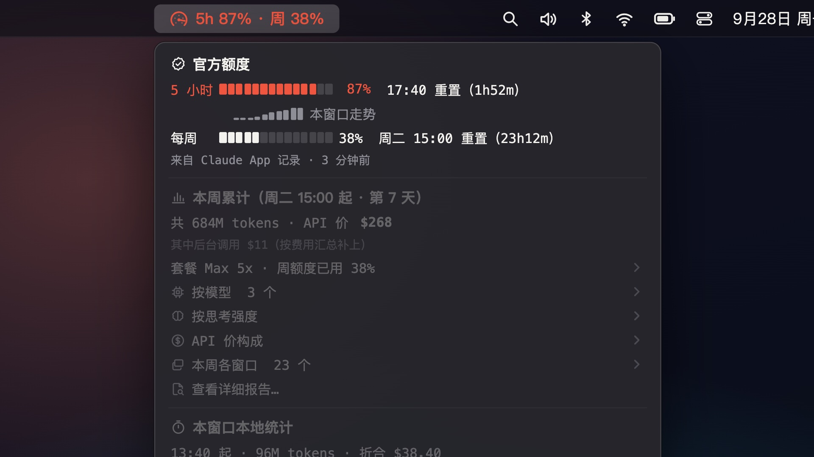
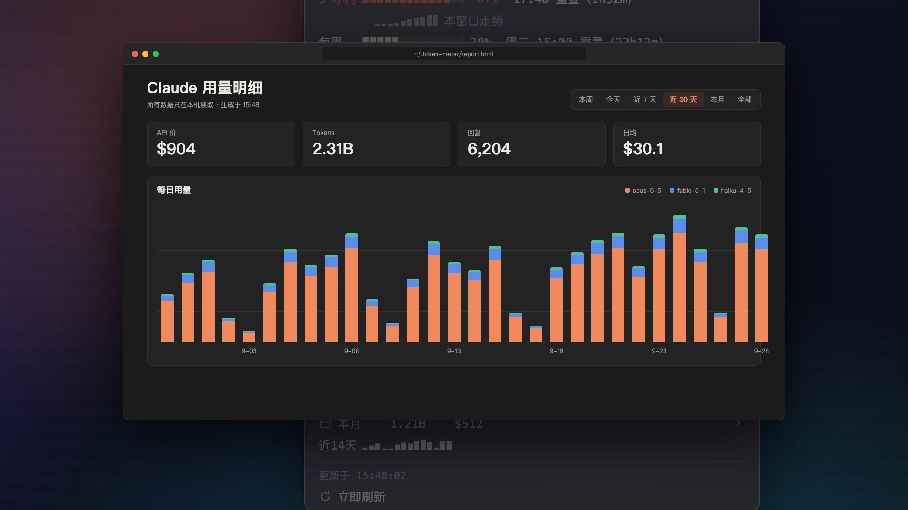

# Claude 用量表 · token-meter

在 Mac 菜单栏里看 [Claude Code](https://claude.com/claude-code) 和 [Codex](https://openai.com/codex) 的用量：官方额度还剩多少、什么时候重置、今天还能用多少、这周按 API 价折合多少钱。

[](https://github.com/6400550-svg/token-meter/actions/workflows/ci.yml)
[](LICENSE)




一个 [SwiftBar](https://swiftbar.app) 插件，单个 Python 文件，只用标准库。每分钟刷新一次。

## 能看到什么

**Claude**
- **官方额度**：5 小时额度、每周额度各用了百分之几，几点重置（来自 Claude 桌面 App 的记录）。快满时菜单栏变黄、变红。
- **今日额度**：周额度平分到 7 天，进度条显示今天已用 / 可用。哪天没用完会累积到下一天，前几天超用了后面就少；还会按你现在的速度预测到重置时会用到多少、会不会提前用完。
- **本周累计**：一共多少 tokens、按 Anthropic API 单价折合多少钱、是套餐周费的几倍；按模型、按思考强度（max / xhigh / high / medium）、API 价构成（输入 / 输出 / 缓存写 / 缓存读）、每个对话窗口各用了多少。
- **后台调用也算进去**：标题生成、权限判断这些不写进会话记录的请求，按 Claude Code 每次运行结束时的费用汇总补上。
- 当前 5 小时窗口、今日、近 7 天、本月、近 14 天走势、本月项目排行；通过代理用的第三方模型（GLM、DeepSeek 等）单独列出。

**Codex**（装了 Codex 才会出现）
- **官方额度**：5 小时 / 每周用了百分之几，精确的重置时间；同样有今日额度进度条。用到 60% 以上时菜单栏上也会显示。
- **本周用量**：按模型、按思考强度、每个线程（子代理算在发起它的线程里）各用了多少 tokens。
- OpenAI 没有公布这些模型的 API 单价，所以 Codex 只统计 tokens，不折算钱。

**详细报告**：菜单里点「查看详细报告…」，在浏览器里打开一个本地页面，有每日用量图、可排序的表格，能切换本周 / 今天 / 近 7 天 / 近 30 天 / 本月 / 全部。



## 安装

1. 到 [Releases](https://github.com/6400550-svg/token-meter/releases/latest) 下载 `token-meter-*.zip`，双击解压（或者点页面上方的 Code → Download ZIP）。
2. 双击 `安装.command`。
   - 如果提示「无法打开，因为来自身份不明的开发者」：右键点它 → 打开 → 再点「打开」。
   - 或者打开「终端」，输入 `bash ` 再把 `安装.command` 拖进去，回车。
3. 按提示选你的套餐（Pro / Max 5x / Max 20x）和每周额度的重置时间（在 Claude 桌面 App → 设置 → 用量 里能看到），都可以直接回车跳过。
4. 看屏幕右上角，出现「5h xx% · 周 xx%」就装好了，点开看详细。

安装程序会自动检查并安装需要的东西：Python 3（没有的话会弹出苹果的「命令行开发者工具」安装窗口）和 SwiftBar（有 Homebrew 会自动装，没有会打开下载页）。

重新双击 `安装.command` 可以改套餐和重置时间；设置保存在 `~/.token-meter/config.json`。双击 `卸载.command` 卸载。

### 手动安装

把 `tokens.1m.py` 放进 SwiftBar 的插件目录，`chmod +x`，必要时把第一行改成你的 python3 路径。可选的 `~/.token-meter/config.json`：

```json
{ "plan": "max5x", "weekly_reset_utc": "2026-09-29T22:00:00+00:00" }
```

`plan` 可以是 `pro` / `max5x` / `max20x`；`weekly_reset_utc` 是任意一次每周额度重置的时刻（UTC），之后每 7 天一次。

## 数据从哪来 · 隐私

**只在本机读文件，不联网，不上传，没有任何遥测。** 读取的位置：

| 内容 | 位置 |
|---|---|
| Claude Code 会话记录（每条回复的 token 用量） | `~/.claude/projects/**/*.jsonl` |
| Cowork 会话记录、桌面 App 窗口标题 | `~/Library/Application Support/Claude/` 下的会话目录 |
| Claude 官方额度（桌面 App 每 15 分钟记一次） | `~/Library/Application Support/Claude/plan-usage-history.json` |
| Codex 用量、官方额度、线程标题 | `~/.codex/sessions/**/rollout-*.jsonl`、`~/.codex/session_index.jsonl` |

只解析用量、额度、模型、标题这几类记录，不读对话内容，也不碰登录凭据。统计结果缓存在 `~/.token-meter/`（增量读取，Claude Code 清理掉旧会话后历史仍保留）。

## 说明

- 「API 价」是按 Anthropic 官方 API 单价折算的，用来看用量值多少钱；订阅套餐并不按这个收费。新模型出来时需要更新文件里的 `PRICES`。
- 官方额度百分比来自 Claude 桌面 App。没装或没开桌面 App 时，菜单栏改为显示今日 token 数，其它本地统计照常。
- 思考强度从 2026 年 9 月起才有记录，更早的显示为「未记录」。
- 只统计本机的 Claude Code（终端、桌面 App 的 Code 页和 Cowork、IDE 插件）和 Codex；网页版 claude.ai / ChatGPT 的聊天不在里面。

## 免责声明

非官方小工具，与 Anthropic、OpenAI 没有任何关系。Claude 是 Anthropic 的商标，Codex 是 OpenAI 的商标。

## License

[MIT](LICENSE)
